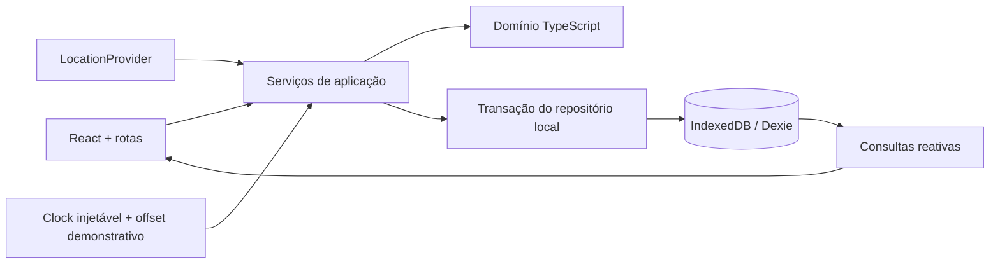

# Arquitetura e evolução

## O que foi implementado

`createApplication(clock)` permite substituir a fonte de tempo. `LocationProvider` isola a API do navegador. A interface da aplicação consome serviços, nunca altera arrays persistidos diretamente. Uma transação read/write serializa cada operação; uma segunda tentativa de check-in encontra a sessão criada pela primeira.

O banco local contém um agregado `AppData` e uma tabela `media` de blobs. Essa escolha é intencional para um protótipo pequeno: consistência e facilidade de restauração. Não deve ser transportada para produção como uma única linha JSON.

## Invariantes

- Pessoa: uma sessão ativa. A sessão aponta para um point, comunidade e, opcionalmente, evento.
- Contabilização: união dos intervalos válidos por sessão. Pontuação por minuto; horas coletivas somam tempo de pessoas diferentes, inclusive quando simultâneo.
- GPS: dois extremos válidos, amostras frescas e intervalo máximo de 30 segundos; pausa por falta de precisão, saída, suspensão e negação. Não existe backfill na reabertura ou no checkout.
- Eventos: presença vinculada ao evento e RSVP aceito; crédito recortado entre início e fim. Regras congeladas após o início. Badge somente após fim, idempotente por pessoa/evento e com snapshot de imagem/título/descrição/data/comunidade.
- Território: maior soma no point e mês; empate preserva o ocupante. `ownership` mantém o incumbente, e as horas continuam derivadas da presença.
- Temporada: mês civil de São Paulo. Os limites mensais são calculados em UTC equivalente a meia-noite UTC−03, adequado ao cenário brasileiro atual; uma futura mudança de horário legal exigirá trocar o conversor por uma biblioteca temporal com banco IANA.
- Recompensas: fundo demonstrativo em centavos; rateio proporcional por duração positiva e distribuição dos centavos restantes pelo maior resto, com desempate estável. Sem presença não há alocação.
- História: remover membros não elimina presença nem medalhas. O criador permanece responsável pela comunidade.

## Próxima etapa: produto conectado

1. Extrair os tipos e regras puros para um pacote compartilhado. Manter UI web separada e criar o aplicativo Expo consumindo os mesmos contratos.
2. Substituir o repositório local por uma API TypeScript em um monólito modular: identidade, comunidades, social, conversas, eventos, presença, territórios e temporadas.
3. Usar PostgreSQL/PostGIS com tabelas normalizadas para usuários, vínculos, points, eventos/RSVPs, sessões/amostras, intervalos, badges, conversas, mensagens e ledger. Índices geográficos para proximidade; índices por comunidade, tempo e participante.
4. Autenticação real e autorização em todas as operações do servidor. Uploads para storage privado com URLs assinadas e validação de mídia. Canais WebSocket autenticados por conversa para chat e atualizações territoriais.
5. O servidor recebe amostras, usa seu próprio relógio, decide os intervalos e registra um ledger auditável/idempotente. Aplicar bloqueios/restrições transacionais para sessão única e processamento concorrente. O cliente não determina pontos ou elegibilidade.
6. Jobs fecham eventos, concedem badges e arquivam temporadas com chaves idempotentes; métricas de atraso, rejeição de amostras, disputa de liderança e falhas de entrega acompanham a operação.
7. No mobile, implementar permissões e coleta de presença com o ciclo de vida nativo. Definir política de precisão, privacidade, retenção e sinais de adulteração antes de habilitar qualquer recompensa econômica.
8. Só então adicionar cobrança, entitlements verificados no servidor e, separadamente, uma operação de recompensas com origem do fundo e regras aprovadas. Nenhum valor da demonstração deve virar saldo real.

## Estratégia de validação

Os testes automatizados cobrem soma coletiva, empates, troca de liderança, virada em São Paulo, slots, rateio exato, sessões concorrentes, lacunas, GPS inválido, permissões, DMs únicas, edição de evento, badge e persistência. IndexedDB é emulado apenas nos testes, usando `fake-indexeddb`.

A validação visual e funcional usa o app real em navegador, nos tamanhos 390, 768 e 1440px, incluindo dialogs, nova comunidade, publicação, conversa e ciclo de evento até troféu. A navegação oferece lista e mensagens de recuperação em indisponibilidade do mapa ou armazenamento.
